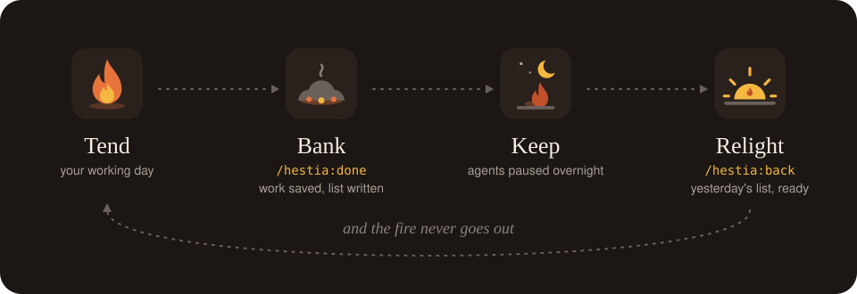

<p align="center">
  
</p>

<h1 align="center">Hestia</h1>

<p align="center">
  
  
  
</p>

**One command that ends the working day in Claude Code.** `/hestia:done` banks whatever you have open, writes tomorrow's first move, and stops your agents until morning.

- **Your work is saved without being touched.** Uncommitted changes in every repo you worked in today go into a `refs/hestia/<timestamp>` snapshot. Your branch, working tree and index stay exactly as they were.
- **The agents stop when you do.** Unattended Claude Code runs get `SIGTERM`. Open sessions are paused by a hook until the next working morning.
- **Picking back up is guaranteed, once.** The first session next morning is handed yesterday's list automatically, a single time, then Hestia goes quiet. No alerts, no prompts, nothing always on screen.

<p align="center">
  
</p>
<p align="center"><em>Tend the fire by day, bank it with <code>/hestia:done</code>, keep it overnight, relight it in the morning.</em></p>

## Get started

In Claude Code:

```text
/plugin marketplace add Lukallo/hestia
/plugin install hestia@hestia
```

Needs `git` and `python3`. No other dependencies: the engine is standard library only.

Once, to set up (about a minute; every question is skippable and has a default):

```text
/hestia:init
```

At the end of the day, type:

```text
/hestia:done
```

That's it. You get:

```text
~/.hestia/
├── TOMORROW.md     tomorrow's list: your note, where you left off, the exact restore line
├── pause.json      when the pause or break lifts (gone after /hestia:back)
├── handover.json   makes sure the morning handover happens only once
├── digest.json     the last Claude Code version /hestia:new told you about
├── profile.json    your answers from /hestia:init
├── connectors.json which connectors Hestia may use, asked once each
└── config.json     your working days and resume hour

~/.claude/CLAUDE.md
└── a short "Hestia: about me" section, between its own markers

<each repo you touched today>
└── refs/hestia/<timestamp>   a snapshot of your uncommitted work
```

<p align="center"></p>

## AI removed the natural end of the workday


Hestia is the Greek goddess of the hearth, and her one job was to keep the fire going. A fire that burns too hot burns out. A fire that's tended, banked at night and relit in the morning lasts. This tool doesn't help you burn brighter.

Each task finishes faster, so there's always one more that fits. With agents running, the work keeps going whether you're there or not. Stopping has become a deliberate act, and nobody has built the act. Starting work has infinite tooling. Ending it has none.

So the day doesn't end. It just thins out.

The reason people don't stop isn't discipline. Stopping feels like dropping something: the fear is losing the thread. So shutting down is only possible if picking back up is guaranteed. That's the whole mechanism here.

Burnout research splits recovery into breaks during the day and *detaching* in the evening: not doing the work, and not thinking about it either. AI compression erodes both. The waits that used to give breaks for free are gone, and the day has no finish line. [PLAN.md](PLAN.md) maps each cause onto the piece that answers it.

### Who it's for

People who build with Claude Code every day, run several sessions or repos at once, and find it hard to stop.

### The brief

Built for the Claude Code Impact Lab, Dublin. The brief: **a shutdown command**. Its one rule is that it has to give time back, not help you do more.

<p align="center"></p>

## Eight commands, two hooks, nothing else

| | Command | What happens |
|---|---|---|
|  | `/hestia:init` | Once. Finds what's already set up (your name, usual hours, connectors), then asks four skippable questions: your day, why you build, who it helps, how to talk to you. Saves a short section to `~/.claude/CLAUDE.md` so every session explains changes by what they do for people first |
|  | `/hestia:done [note]` | Saves open work in every repo you touched today, writes tomorrow's list, and pauses Claude until the next working morning |
|  | `/hestia:break [45m]` | Saves where you are and pauses agents for that long, then lifts itself. No list, because the day isn't over |
|  | `/hestia:back` | Lifts a pause or break early, and reminds you of the one thing you were mid-way through |
|  | `/hestia:today` | Whether you're paused or on a break, and today's load, only ever when you ask |
|  | `/hestia:dashboard` | The same reading on one static page: when you worked today, saved snapshots and tomorrow's list. It opens when you ask and never refreshes |
|  | `/hestia:why [who for]` | One plain paragraph on who today's work helps, built from your real commits and prompts. Paste it into an update instead of writing one |
|  | `/hestia:new` | Reads only what changed in Claude Code since your version or your last check, and shows you **one** thing from it, in five lines |

Plus two things that happen on their own, and nothing else:

| | When | What happens |
|---|---|---|
|  | *at shutdown* | Unattended agents are sent `SIGTERM`. Interactive sessions are left alone and reported; a `PreToolUse` hook stops them at their next step instead of killing a window you're sitting in front of |
|  | *next morning* | A `SessionStart` hook hands yesterday's list to the first session after the pause, **once**, then goes quiet |

The second one is the whole trick. The context you left with is given back automatically, and exactly once, because a recap on every session is just noise.

> [!TIP]
> While paused or on a break, the hook blocks every tool call except the way back in. `/hestia:back` is explicitly allowlisted, so you can never lock yourself out.

### Stopping agents, carefully

A headless run (`claude --print`, `--output-format`) has nobody watching it, so it's the kind that quietly burns all night. Those get `SIGTERM`: graceful, never `SIGKILL`.

An interactive session has a person at it, so killing it would take work away rather than give time back. It's reported and paused instead.

Hestia never signals its own process or anything that spawned it, so the command can't stop itself. `--keep-agents` reports without stopping anything; `--stop-all` includes interactive sessions.

A break is different. Nothing is sent `SIGTERM` by default, because a headless run's work should still be there when you're back in an hour. The hook pauses it at its next step instead. `break --stop-agents` stops headless runs too.

<p align="center"></p>

## What you'll see: real output, one run

Everything below was captured from a run of the engine against a throwaway repo, with `HESTIA_HOME` pointed at a temp folder so it didn't pause a live session.

> [!NOTE]
> The only edit is shortening the temp paths to `~/.hestia` and `/path/to/demo`. The run used `--keep-agents`, so nothing was signalled.

**Ending the day** (`/hestia:done unblocking the CSV import for the ops team`):

```text
Clocked out until Fri 30 Oct 08:00.
  saved 2 files in demo -> refs/hestia/2026-10-29-182042
  tomorrow's list: ~/.hestia/TOMORROW.md
```

Three lines, and it stops. When Claude sessions are still open, a fourth line reports them: `1 Claude session still open - paused, they'll stop at their next step`.

**What it leaves for the morning** (`~/.hestia/TOMORROW.md`):

```markdown
# Tomorrow - Thu 29 Oct

> unblocking the CSV import for the ops team

## Where you left off

- **demo** (main) - 2 files saved
  `git -C /path/to/demo checkout refs/hestia/2026-10-29-182042 -- .`

## Today

- no prompts recorded today

## Overnight

- nothing was running
```

The throwaway setup has no session history, so `Today` is empty. On a real machine it fills in with the same numbers `/hestia:today` reports.

**If a session tries to work while you're clocked out** (the `PreToolUse` hook's answer to an `Edit`):

```text
{"hookSpecificOutput": {"hookEventName": "PreToolUse", "permissionDecision": "deny", "permissionDecisionReason": "Clocked out until Fri 30 Oct 08:00. Run /hestia:back if tonight can't wait."}}
```

**Coming back early** (`/hestia:back`):

```text
Back on. Paused since Thu 29 Oct 18:20.
Yesterday's list: ~/.hestia/TOMORROW.md
```

The first new session after that receives `TOMORROW.md` as context. A second session start prints nothing.

**Checking in, when you ask** (`/hestia:today`, on a real machine):

```text
Working.
  14 prompts across 1 project, 0.8 hours from first to last
  no break longer than 20 minutes today
```

**Taking a break, and the other two commands.** These come from a second run, separate from the one above, against a different throwaway repo with two commits made that day. As before, `HESTIA_HOME` pointed at a temp folder and the only edit is shortening the temp path to `/path/to/demo`.

`/hestia:break 45m`:

```text
On a break until 19:27.
  saved 2 files in demo -> refs/hestia/2026-10-29-184216
  1 Claude session paused, they'll stop at their next step
```

The third line is a real Claude Code window that was open on the machine. A break reports it and leaves it to the hook; it signals nothing.

`/hestia:today` during the break, and the hook's answer to an `Edit`:

```text
On a break until 19:27.
  no prompts recorded today
```

```text
{"hookSpecificOutput": {"hookEventName": "PreToolUse", "permissionDecision": "deny", "permissionDecisionReason": "On a break until 19:27. Run /hestia:back to end it early."}}
```

`/hestia:back`, which hands back where you were before the break rather than yesterday's list:

```text
Back on. On a break since 18:42.
Before the break: git -C /path/to/demo checkout refs/hestia/2026-10-29-184216 -- .
```

The facts `/hestia:why` writes its paragraph from. The command reads them as JSON and turns them into plain language; this is the same data as text:

```text
What the work since Thu 29 Oct touched:
  demo (main): 2 commits, 2 files uncommitted
    91b73e4 Accept semicolon-separated exports in the CSV import
    db06b6b Start the CSV import for the ops team
  0 prompts
```

The facts `/hestia:new` picks its one item from. `--since` was set three releases back so there was something to show:

```text
3 releases since 2.1.309 (you have 2.1.312):
  2.1.312  39 changes
  2.1.311  92 changes
  2.1.310  26 changes
```

Run again with nothing new since the last check:

```text
Nothing new since 2.1.312.
```

<p align="center"></p>

## Your work is saved without touching your repo

Hestia builds the snapshot commit through a **temporary git index**, so your working tree, your real index and your current branch are left exactly as they were:

```text
GIT_INDEX_FILE=<temp> git read-tree HEAD
GIT_INDEX_FILE=<temp> git add -A
git commit-tree <tree> -p HEAD    ->  git update-ref refs/hestia/<timestamp>
```

Nothing is stashed, nothing is committed to your branch, nothing moves. The test suite asserts that `.git/index` is **byte-identical** before and after.

**To get your work back:**

```text
git -C <repo> checkout refs/hestia/<timestamp> -- .
```

The exact line, with the real timestamp, is written into tomorrow's list.

### What it touches, and how to undo it

| Thing | Where | Undo |
|---|---|---|
| Snapshots | `refs/hestia/*` in each repo | `git update-ref -d refs/hestia/<ts>` |
| Pause or break state | `~/.hestia/pause.json` | `/hestia:back`, or delete the file |
| Last version `new` showed | `~/.hestia/digest.json` | delete it to see the same changes again |
| Handover marker | `~/.hestia/handover.json` | delete it to get the list again |
| Tomorrow's list | `~/.hestia/TOMORROW.md` | delete it |
| Config | `~/.hestia/config.json` | delete it |
| Your answers | `~/.hestia/profile.json` | delete it |
| Connector choices | `~/.hestia/connectors.json` | delete it, or re-run `/hestia:init` to change a choice |
| About-me section | `~/.claude/CLAUDE.md`, between `<!-- hestia:start -->` and `<!-- hestia:end -->` | `/hestia:init remove` puts the file back byte for byte (a backup is kept in `~/.hestia/backups/`) |
| Dashboard page | `~/.hestia/dashboard.html`, only after `/hestia:dashboard` | delete it |

It never edits your `settings.json`, never writes into your repos' working trees, and never pushes anything. `/hestia:new` is the only piece that uses the network, and only to read Claude Code's public changelog. It only touches `CLAUDE.md` inside its own markers, and only when you run `/hestia:init`.

<p align="center"></p>

## Prove it: 32 checks, 63 tests

One command builds a throwaway repo, runs the whole flow, and checks every claim on this page:

```text
python3 plugins/hestia/scripts/hestia.py selftest
```

Real output:

```text
PASS done runs
PASS snapshot saved the work
PASS snapshot reported untouched
PASS branch unchanged
PASS working tree unchanged
PASS index byte-identical
PASS uncommitted file is recoverable
PASS tomorrow's list written
PASS hook blocks tool use while paused
PASS hook blocks edits while paused
PASS hook always allows back
PASS no handover while still paused
PASS back runs
PASS old names still work as aliases
PASS morning gets yesterday's list
PASS handover carries the note
PASS handover happens only once
PASS hook is silent after back
PASS expired pause clears itself
PASS break runs
PASS break saves where you are
PASS hook pauses agents during a break
PASS break writes no list
PASS back ends a break early
PASS break lifts itself
PASS why reads today's commits
PASS new shows only what changed
PASS new is quiet when nothing changed
PASS new degrades cleanly offline
PASS init writes profile, config and connectors
PASS init keeps CLAUDE.md outside its markers
PASS init remove restores CLAUDE.md exactly

32/32 checks passed
```

The selftest runs `done` with `--keep-agents` and `break` without `--stop-agents`, so it never touches real processes. Its `new` checks read a local changelog file, so it runs offline.

The 63 unit tests run against real git repositories in temp directories. Nothing is mocked:

```text
python3 -m unittest discover -s tests -v
```

```text
Ran 63 tests in 14.664s

OK
```

<p align="center"></p>

## What it deliberately doesn't do

The brief's one rule is that it has to give time back, not help you do more. So:

- **No notifications, reminders or nudges.** Nothing ever interrupts you. Every command runs because you typed it.
- **No live dashboard.** The workload numbers live inside `/hestia:today`, and `/hestia:dashboard` writes the same facts to a static page, both only when asked. Nothing refreshes, nothing sits open in a tab, and there are no totals or comparisons. A thing you have to check is a thing that costs attention.
- **No streaks, scores or goals.** Measuring rest turns rest into work.
- **No summary at shutdown.** `/hestia:done` answers in three lines and stops. A command that ends the day shouldn't give you more to read.
- **No break suggestions.** `/hestia:break` says when it ends and what it saved. What you do on it is yours.
- **No release digest.** `/hestia:new` shows one change, not the woodpile, and says nothing at all when nothing changed.

The time it saves is the stashing, the "where was I?" note, the morning re-orientation, and the agents that would otherwise have run all night.

## Scope

All six commands that [PLAN.md](PLAN.md) designs are built, plus two added later: `/hestia:init` and `/hestia:dashboard`. The automatic pieces it describes beyond the two hooks are not: the opt-in lunch break, the recap on your first prompt after a break, the finish line ("3 of 5 done"), catch-up on what agents did while you were away, and parking prompts typed while paused. Each one would add a hook that runs on every prompt or turn, so they wait until the commands have been used for real.

## Honest limitations

- Agent stopping only reaches Claude Code processes on **this machine**, found via `ps`.
- On Windows the pause works, but nothing is signalled, and the hooks call `python3`.
- `/hestia:new` needs the network. Offline it says it couldn't check, and does nothing else.
- We can't claim burnout goes down. We can claim the day has an end, the agents stopped, and nothing ran between shutdown and morning.

<details>
<summary><b>Limitations in detail</b></summary>

- Agent stopping finds Claude Code processes on **this machine**, via `ps`. A run on a CI box, a remote host or inside a container keeps going; so does anything not launched as `claude`.
- Process detection is POSIX (`ps`, `SIGTERM`). On Windows the pause still works (the hook blocks the next step), but nothing is signalled.
- The handover fires on `SessionStart` with the `startup` matcher, so resuming an existing session with `--continue` won't re-deliver the list. That's deliberate: it's already in that session's context.
- While paused, Claude won't act on anything, including for you. That's deliberate, but it means `/hestia:back` is the only way back in tonight. The hook allowlists that command explicitly so you can never lock yourself out.
- A break pauses headless runs at their next tool call instead of stopping them. A run that is between tool calls when the break starts will finish its current model turn first.
- A break can't be taken while clocked out for the night. It refuses rather than shortening the overnight pause. Breaks longer than four hours are refused too: that's the end of the day, which is what `/hestia:done` is for.
- `/hestia:why` only knows what's in your commits, open changes, today's prompts and your last shutdown note. It reports your own commits only, matched on the identity git would commit as.
- Two sessions starting at the same moment can both receive the morning handover. The marker file has no lock.
- Repo discovery reads the `cwd` of today's prompts from `~/.claude/projects`. If you worked somewhere Claude Code never saw, add it to `repos` in the config.
- We can't claim burnout goes down; that takes weeks to show. What we can claim is that the day has an end, the agents stopped overnight, and nothing ran between shutdown and morning.
- Developed on macOS and Linux. The selftest and unit tests also pass on Windows 11 with Python 3.13, but the plugin hasn't been run end to end inside Claude Code on Windows. The hooks invoke `python3`; on Windows that is usually `python`, so edit `hooks/hooks.json` accordingly.

</details>

<p align="center"></p>

## Use it your way

<details>
<summary><b>Without Claude Code: the engine is a plain CLI</b></summary>

```text
python3 plugins/hestia/scripts/hestia.py done --note "shipped the import fix"
python3 plugins/hestia/scripts/hestia.py break 45m
python3 plugins/hestia/scripts/hestia.py today
python3 plugins/hestia/scripts/hestia.py dashboard
python3 plugins/hestia/scripts/hestia.py back
python3 plugins/hestia/scripts/hestia.py why
python3 plugins/hestia/scripts/hestia.py new
```

`break` takes `45m`, `1h30m`, `90` or an end time like `13:50`, plus `--stop-agents` and `--json`. `why` takes `--days N`, `--repo PATH` and `--json`. `new` takes `--since VERSION` and `--json`.

`shutdown` also takes `--until HH:MM` (or an ISO timestamp), `--keep-agents`, `--stop-all` and `--json`. `status` takes `--json`. `dashboard` takes `--out PATH` and `--no-open`.

</details>

<details>
<summary><b>Config: resume hour, working days, extra repos</b></summary>

Optional, at `~/.hestia/config.json`:

```json
{
  "resume_hour": 8,
  "working_days": [0, 1, 2, 3, 4],
  "repos": ["/Users/you/code/side-project"]
}
```

`working_days` is Monday = 0. Shutting down on a Friday evening resumes Monday morning.

</details>

<p align="center"></p>

## Project links

- [PLAN.md](PLAN.md): the full design, the burnout grounding, and the audit of what was cut and why.
- [assets/BRAND.md](assets/BRAND.md): the visual identity, palette and icon rules.
- [REFERENCE.md](REFERENCE.md): projects we learned from, and what we took from each.
